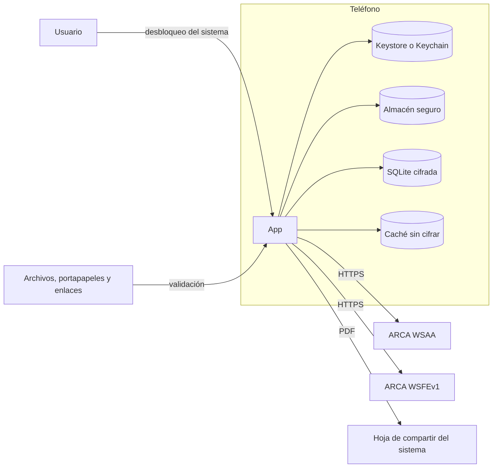

# Modelo de amenazas

Qué protege Facturador Fácil, de quién y cómo. Sirve para revisar cada cambio que toque datos, claves o la conexión con ARCA, y para priorizar el trabajo de seguridad.

Última revisión: 2026-10-28. Se revisa al agregar una integración, un dato nuevo o una forma de publicar la app, y como mínimo antes de cada publicación en las tiendas.

## Alcance y supuestos

* La app corre en el teléfono del contribuyente y habla directamente con ARCA, sin servidor propio ([ADR 0002](../adr/0002_local_first_y_claves_en_dispositivo.md)). Además lee del repositorio la versión mínima vigente, sin enviar datos.
* El sistema operativo no está comprometido. Un teléfono con root o jailbreak queda fuera del modelo: ahí ninguna protección de la app es confiable.
* ARCA y su infraestructura TLS son confiables.
* Fuera de alcance por ahora: sincronización entre teléfonos, padrón de ARCA (#30), publicación en tiendas (#63).

## Activos

| Activo | Dónde vive | Por qué importa |
| --- | --- | --- |
| Clave privada del certificado | Keystore de Android o Keychain de iOS, no exportable | Con ella se emiten comprobantes en nombre del contribuyente |
| Ticket de acceso de WSAA | Almacén seguro (expo-secure-store) | Permite facturar hasta que vence, unas 12 horas |
| Certificado de ARCA | Almacén seguro | Público, pero define con qué CUIT y ambiente se factura |
| Datos del emisor y ambiente | Almacén seguro | Datos personales; cambiar el ambiente a producción emite comprobantes con validez fiscal |
| Receptores frecuentes | Almacén seguro | Datos personales de clientes |
| Comprobantes emitidos | Base SQLite cifrada con SQLCipher; la clave de 256 bits en el almacén seguro | Registro fiscal con datos de clientes e importes |
| Logo del emisor | Documentos de la app, sin cifrar | Público: va impreso en cada comprobante |
| Parámetros de ARCA | Caché de la app, sin cifrar | Datos públicos de ARCA; el nombre del archivo incluye el CUIT del emisor |
| Cuentas de GitHub y Expo, keystore de firma de Android | GitHub y servidores de EAS | Quien las controle puede publicar una versión maliciosa de la app |

## Actores

* **Quien encuentra o roba el teléfono**, bloqueado o desbloqueado.
* **Otra app instalada en el mismo teléfono**, sin privilegios especiales.
* **Un atacante en la red**, como un Wi-Fi público.
* **Quien manda un enlace o un archivo** al usuario: un deep link, un certificado o una imagen preparados.
* **Una dependencia comprometida** en la cadena de suministro de npm.
* **Quien toma una de las cuentas del proyecto** en GitHub o Expo.

## Flujo de datos y límites de confianza

Los límites de confianza son: la red, todo lo que entra desde afuera de la app (archivos, portapapeles, deep links, respuestas de ARCA) y lo que sale hacia otras apps al compartir.

## Amenazas por categoría (STRIDE)

### Suplantación

| Amenaza | Mitigación | Estado |
| --- | --- | --- |
| Alguien con el teléfono desbloqueado abre la app y emite | Desbloqueo con la biometría o el PIN del sistema al abrir y al volver después de la espera elegida; el sistema limita los intentos. Sin bloqueo de pantalla, la app lo advierte | Cumple |
| Se usa la clave privada con el teléfono bloqueado | iOS: `WhenUnlockedThisDeviceOnly`. Android 9 o posterior: `setUnlockedDeviceRequired`. Por eso la clave solo se crea con bloqueo de pantalla configurado. Si la firma falla, no se envía nada a ARCA y se puede reintentar | Cumple |
| Se carga un certificado ajeno o de otro ambiente | Se valida el emisor ARCA del ambiente, el CUIT, que corresponda a la clave del teléfono y la vigencia | Cumple |
| Un servidor falso se hace pasar por ARCA | TLS validado por el sistema; nunca se desactiva. URLs fijas en el código | Cumple |
| El ARCA simulado de las pruebas llega a un build publicado y da CAE falsos | Solo se incluye con una variable fijada al compilar; el CI comprueba en cada PR que el bundle publicado no lo tenga. Además solo atiende las direcciones de homologación | Cumple |
| Alguien toma la cuenta de GitHub o Expo y publica un build | Segundo factor y custodia del keystore | Pendiente, #134 |

### Manipulación

| Amenaza | Mitigación | Estado |
| --- | --- | --- |
| Inyección SQL con datos de un cliente | Consultas con parámetros; una regla de ESLint impide armar SQL con valores | Cumple |
| Un nombre o una descripción con HTML alteran el PDF | Todo texto se escapa; política de contenido sin scripts ni recursos externos | Cumple |
| Una imagen preparada para agotar memoria o colar contenido | Validación por contenido, límite de 10 MB y 24 millones de píxeles antes de decodificar, y se vuelve a codificar como un PNG propio | Cumple |
| Datos guardados dañados o alterados | Todo lo que se lee del almacenamiento se valida como una entrada; lo inválido se descarta | Cumple |
| Una dependencia comprometida | Solo versiones con 14 días publicadas, auditoría en cada PR, acciones de CI fijadas por commit, Dependabot con la misma espera | Cumple |

### Repudio

| Amenaza | Mitigación | Estado |
| --- | --- | --- |
| El usuario no puede probar qué emitió | ARCA registra cada comprobante con su CAE; la app guarda una copia local de cada comprobante autorizado | Cumple |

### Divulgación de información

| Amenaza | Mitigación | Estado |
| --- | --- | --- |
| Se extraen datos de un teléfono perdido | Secretos en el almacén seguro; comprobantes en una base cifrada; la clave privada no es exportable | Cumple |
| Los datos salen en un respaldo del sistema | Android: `allowBackup` desactivado. iOS: la base cifrada entra en iCloud, pero sin su clave, que no viaja, es ilegible | Cumple; mejora anotada en #93 |
| Alguien obtiene el archivo de respaldo de la app | Cifrado con XChaCha20-Poly1305 y una clave derivada de la contraseña con PBKDF2 de 600.000 iteraciones; sin la clave privada ni el certificado (ADR 0006) | Cumple, #62 |
| Un respaldo manipulado ataca la importación | Un único archivo sin zip, tope de tamaño, costo de derivación acotado, etiqueta verificada antes de leer y cada comprobante validado como lo guardado | Cumple, #62 |
| Capturas de pantalla o la vista previa del selector de apps | Android bloquea capturas y grabaciones; iOS las oculta en grabaciones y desenfoca la vista previa | Cumple |
| Los registros exponen datos fiscales | Un único registro que tapa CUIT, DNI, CAE, tokens e importes; en producción, solo mensajes fijos | Cumple |
| El teclado aprende nombres y CUIT de clientes | Teclado en modo incógnito en toda la app (Android) y campos de datos personales sin sugerencias | Cumple, #136 |
| Otra app lee la caché | La caché vive en el área privada de la app y solo tiene datos públicos de ARCA | Riesgo aceptado |
| Un enlace abre una pantalla con datos | Todo deep link lleva al inicio | Cumple |

### Denegación de servicio

| Amenaza | Mitigación | Estado |
| --- | --- | --- |
| ARCA no responde | Tiempo máximo de 30 segundos y reintento que averigua si el comprobante se autorizó, sin duplicarlo | Cumple |
| Un archivo enorme cuelga la app | Tamaño máximo antes de leer certificados e imágenes | Cumple |
| La base no se puede abrir | Sin su clave, se descarta y se crea una nueva; la emisión no depende de poder guardar | Cumple |

### Elevación de privilegios

| Amenaza | Mitigación | Estado |
| --- | --- | --- |
| La app tiene permisos de más | Solo internet, biometría, vibración y detección de capturas; almacenamiento, galería, cámara, micrófono y dibujar sobre otras apps bloqueados | Cumple |
| Una versión vulnerable sigue en uso | Versión mínima publicada en el repositorio: por debajo, la app no emite. Sin conexión vale la última conocida | Cumple |

## Riesgos aceptados

* **Sin fijación de certificados (pinning) con ARCA.** ARCA rota sus certificados sin aviso y un pin desactualizado dejaría a todos los usuarios sin facturar. La validación TLS del sistema alcanza para el perfil L1.
* **Sin detección de root ni de jailbreak, ni ofuscación.** Corresponden al perfil de resiliencia de MASVS, fuera de L1. En un sistema comprometido no protegerían de verdad.
* **El CUIT del emisor aparece en nombres de archivos de la caché.** Está en el área privada de la app, y el CUIT de quien factura figura en cada comprobante que emite.

## Checklist MASVS, perfil L1

Según [OWASP MASVS v2](https://mas.owasp.org/MASVS/). Los controles de resiliencia no forman parte de L1.

| Control | Requisito | Estado |
| --- | --- | --- |
| MASVS-STORAGE-1 | Los datos sensibles se guardan de forma segura | Cumple: almacén seguro y SQLCipher |
| MASVS-STORAGE-2 | Se evita la fuga de datos sensibles | Cumple: capturas bloqueadas, logs sin datos y teclado sin aprendizaje |
| MASVS-CRYPTO-1 | Criptografía fuerte y actual | Cumple: RSA 2048 con SHA-256 en el hardware del teléfono, AES de SQLCipher |
| MASVS-CRYPTO-2 | Gestión de claves según buenas prácticas | Cumple: claves no exportables, usables solo con el teléfono desbloqueado |
| MASVS-AUTH-1 | Protocolos de autenticación seguros | Cumple: WSAA con CMS firmado en el teléfono |
| MASVS-AUTH-2 | Autenticación local según la plataforma | Cumple: biometría o credencial del sistema |
| MASVS-AUTH-3 | Autenticación adicional para operaciones sensibles | Cumple: confirmación explícita antes de emitir; el desbloqueo se renueva tras la espera |
| MASVS-NETWORK-1 | Todo el tráfico va cifrado | Cumple: solo HTTPS, hacia ARCA y hacia el repositorio |
| MASVS-NETWORK-2 | Fijación de identidad de los servidores | No aplica en L1; riesgo aceptado |
| MASVS-PLATFORM-1 | Comunicación entre apps segura | Cumple: deep links neutralizados; los archivos se comparten por la hoja del sistema |
| MASVS-PLATFORM-2 | WebViews seguras | Cumple: el PDF se arma sin scripts y con política de contenido |
| MASVS-PLATFORM-3 | Interfaz segura | Cumple: capturas bloqueadas y vista previa oculta |
| MASVS-CODE-1 | Plataforma actualizada | Cumple: SDK de Expo vigente; la actualización a SDK 58 está en #102 |
| MASVS-CODE-2 | Mecanismo para forzar actualizaciones | Cumple: versión mínima obligatoria para emitir |
| MASVS-CODE-3 | Sin componentes con vulnerabilidades conocidas | Parcial: avisos de herramientas de desarrollo ignorados con justificación, en revisión en #88 |
| MASVS-CODE-4 | Validación de toda entrada no confiable | Cumple: certificados, imágenes, respuestas de ARCA y datos guardados |
| MASVS-PRIVACY-1 | Acceso mínimo a datos | Cumple: sin servidor propio ni analítica; permisos mínimos |
| MASVS-PRIVACY-2 | Se evita identificar al usuario | Cumple: no se envía nada fuera de ARCA |
| MASVS-PRIVACY-3 | Transparencia sobre los datos | Pendiente: política de privacidad en #63 |
| MASVS-PRIVACY-4 | Control del usuario sobre sus datos | Parcial: puede quitar el logo, cambiar sus datos y llevarse todo en un respaldo cifrado (#62); falta borrar comprobantes |
